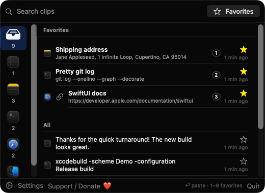
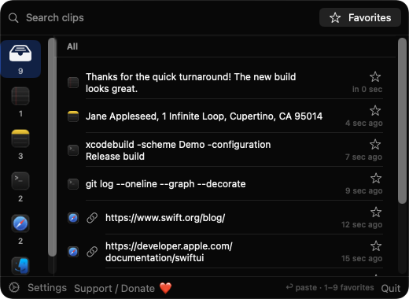
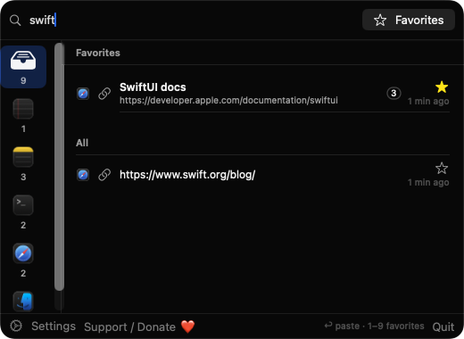
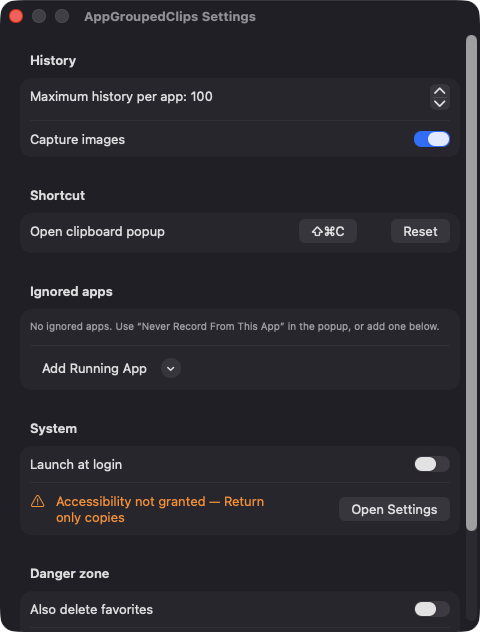

# AppGroupedClips

**🌐 Website:** [turhe123.github.io/app-grouped-clips](https://turhe123.github.io/app-grouped-clips/)

A clipboard history that groups what you copied by the app it came from, with custom labels for favorites.

> 🆓 A free, open-source **CopyLess 2 alternative** for macOS 14+. Native Swift, no accounts, no subscriptions, MIT licensed.


## Why

AppGroupedClips is a free, open-source, 100% native, backend-free alternative to paid utilities in the *Clipboard* category. It was inspired by CopyLess 2 ($9.99 one-time). Everything stays on your Mac: no accounts, no servers, no analytics, and no third-party dependencies, just SwiftUI and AppKit.

## Features

- **Grouped by source app**: each copy is stored with the name and icon of the frontmost app at that moment. The popup has a left column of app icons with counts and a right list of that app's clips. "All" shows a merged timeline.
- **Text, links, images and files**: plain text, links (http/https/mailto/ftp), images (stored as PNG files) and copied files (stored as file paths).
- **Favorites with custom labels**: star any clip, or use Rename Label to name it (e.g. "Billing address"). Labelled clips are kept as favorites and are not removed by history limits.
- **Quick paste**: Return pastes the selected clip into the previous app. Number keys 1–9 paste the first nine favorites. Up/Down move the selection, Escape clears the search or closes the popup, and typing starts a search.
- **Search and Favorites filter**: search matches clip text and labels.
- **Context menu**: Rename Label, Copy Back, Star/Unstar, Delete, and Never Record From *App*.
- **Global hotkey**: ⇧⌘C by default, with a click-to-record control and Reset in Settings.
- **Settings**: maximum history per app (20–500), image capture on/off, an ignored-apps list, launch at login, and Clear History (keeps favorites unless you tick "Also delete favorites").
- **Privacy-minded**: clips marked concealed, transient or auto-generated by the source app (such as password managers) are skipped, and the app never records its own copies.
- **Robust storage**: history is a JSON file in `~/Library/Application Support/AppGroupedClips`. A corrupt file is moved aside with a dated name and you are told in an alert. Identical consecutive copies are merged, and text over 200,000 characters is stored truncated with a visible marker.

## Screenshots

<p align="center"></p>

<p align="center"><em>The menu-bar popup groups clips by source app on the left, with labelled favorites pinned on top and numbered for one-key pasting.</em></p>

<p align="center"></p>

<p align="center"><em>The All view shows a merged timeline of recent text and link clips, each tagged with the icon of the app it was copied from.</em></p>

<p align="center"></p>

<p align="center"><em>Typing filters clips and favorite labels instantly.</em></p>

<p align="center"></p>

<p align="center"><em>Settings cover per-app history limits, image capture, the global shortcut, ignored apps and launch at login.</em></p>

## Install

1. Download `AppGroupedClips-macOS.zip` from the [latest release](https://github.com/turhe123/app-grouped-clips/releases/latest).
2. Unzip it and move `AppGroupedClips.app` to `/Applications`.
3. Because the app is open source and not notarized, clear the quarantine flag:

   ```bash
   xattr -cr /Applications/AppGroupedClips.app
   ```

4. Right-click the app and choose **Open** the first time you launch it.

The app lives in the menu bar (there is no Dock icon window); click the icon or press ⇧⌘C.

## Build from source

Requires macOS 14+ and Xcode with Swift 5.9+.

```bash
brew install xcodegen
xcodegen generate
xcodebuild -project AppGroupedClips.xcodeproj -scheme AppGroupedClips -configuration Release -derivedDataPath ./build build
```

The app is produced at `build/Build/Products/Release/AppGroupedClips.app`.

## Permissions

- **Accessibility**: the only permission the app asks for. It is needed so Return and the 1–9 keys can paste into the previous app by sending a ⌘V key event. The system prompt appears only the first time you try to paste. Without it, the clip is still copied to the clipboard and a notice explains how to enable it in System Settings › Privacy & Security › Accessibility.
- **Login item**: if you enable "Launch at login", macOS registers the app through `SMAppService`.

The code does not use Screen Recording, Microphone, Camera or network access.

## Built with AI

AppGroupedClips was written by [Claude Code](https://claude.com/claude-code) inside an automated pipeline, from a plain-English spec. No code, binaries or assets from any commercial app were used; it is a clean-room reimplementation of a feature set, not a copy.

What that means in practice:

- The full source is in this repo under the MIT license. Read it before you run it.
- No network calls, no analytics, no third-party dependencies. Only Apple frameworks.
- Ad-hoc signed and not notarized, which is why Gatekeeper warns on first launch.
- It has had less human review than a hand-written app. Bug reports and pull requests are welcome.

## Support ❤️

If you find AppGroupedClips useful, you can support its development:

[Support Or (Leo) Davidai ❤️](https://ko-fi.com/leodavidai)

The popup and Settings also have a "Support / Donate ❤️" button.

## More free Mac apps

AppGroupedClips is one of a growing collection of [free, open-source Mac utilities](https://github.com/turhe123/mac-apps) built the same way: native Swift, no accounts, no telemetry. Browse the full gallery at [turhe123.github.io/mac-apps](https://turhe123.github.io/mac-apps/).

Prefer something that runs in the browser? The same pipeline builds [free, private web tools](https://turhe123.github.io/web-tools/): PDF, image, developer, data and audio tools, nothing uploaded.

## License

MIT © Or Davidai Bachar
